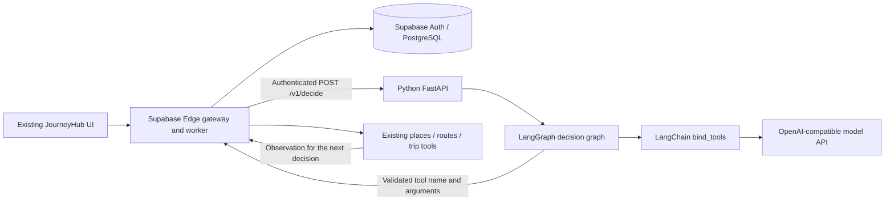

# JourneyHub Python agent service

This service migrates the **decision layer** of the durable traveler planner and
Trip Agent to Python, FastAPI, LangChain and LangGraph. It is integrated into the
existing Edge workers through `decision-runtime.mjs`.

The default runtime remains `legacy` until the Python service and updated Edge
functions have been deployed and checked. A frontend deployment alone does not
enable this backend. No database migration is required.

## Architecture



The Python graph is `model → validate → END`, with a conditional
`validate → repair → model` edge for one correction. LangChain's real
`init_chat_model`, `ChatOpenAI`, message objects and `bind_tools` handle model
requests and tool-call parsing. Pydantic validates the HTTP contract;
`jsonschema` validates the selected tool's arguments. Model prose and hidden
reasoning are not returned to the gateway.

This is a hybrid migration: the **outer action/observation loop and business tool
implementations remain in JavaScript**. PostgreSQL still owns task checkpoints,
leases, request IDs, ownership, history and explicit Apply/payment operations.
There is no second LangGraph checkpoint store or global conversation memory.
The Python service never receives a Supabase service key and cannot write bookings.

Supported decision kinds:

| Kind | Current tools |
| --- | --- |
| `discover` | Search/inspect places, select cards, report limitations |
| `discover_plan` | Inspect/research visits, propose schedules, check routes, finish |
| `trip_chat` | Read saved trip/wallet data, prepare changes or virtual-payment quotes, clarify, respond |

The gateway narrows tools on each turn. Python checks the names against a separate
allow-list and requires exactly one complete call. Unlike the legacy parser,
parallel call batches are rejected and repaired instead of selecting a subset.
No tool can directly charge credits or apply a proposal without the existing
user confirmation flow.

Other AI helpers (Pip, debate, memory recap, official-source extraction and the
older catalog planner) retain their existing provider adapter. Keep their current
Edge model credentials configured. This change does not add RAG or vector search.

## Local setup

Requires Python 3.12 and [uv](https://docs.astral.sh/uv/getting-started/installation/).
From this directory:

```sh
uv sync --frozen
```

Copy `.env.example` to `.env` and fill in `JH_SERVICE_TOKEN` and `JH_MODEL_API_KEY`.
Generate a random service token of at least 32 characters locally, for example
with `python -c "import secrets; print(secrets.token_urlsafe(32))"`. Never paste the
real token in a PR, browser config, screenshot or shell command sent to others.

```sh
uv run --frozen uvicorn journeyhub_agent.app:app --host 127.0.0.1 --port 8000 --no-access-log
```

`GET /healthz` checks process/configuration readiness only; it does not call or
prove connectivity to the model. `/docs` describes the response contract.
Requests to `POST /v1/decide` require `Authorization: Bearer <service-token>` and
`Content-Type: application/json`. The body is defined by `DecisionRequest` in
`journeyhub_agent/contracts.py`: version, agent, system, observation, current tools
and the output-token limit. Provider keys, base URLs and model selection come
only from server configuration, never from request bodies.

For OpenAI, set the model you have access to, `JH_MODEL_BASE_URL=https://api.openai.com/v1`
and `JH_DEEPSEEK_DISABLE_THINKING=false`. The default DeepSeek model identifier is
inherited from the existing project; available models must be checked with the
actual account before rollout.

## Offline verification and demo

From the repository root:

```sh
npm run setup
npm run test:agent
npm run build
npm test
node work/journeyhub/test-trip-chat-payments.cjs
```

`test:agent` installs the locked Python dependencies, runs Ruff and pytest, then
runs the decision transport, cross-language integration and existing agent
regressions. No model key, Supabase project or user login is needed.

The cross-language test starts a temporary loopback FastAPI server, exercises the
real LangChain provider serializer and LangGraph nodes, executes the existing
JavaScript domain tools, and shuts the server down. It demonstrates:

- Rejection and repair of an unregistered tool; usage includes both attempts.
- Saved-trip information lookup and replies for two isolated account snapshots.
- Discovery search/card selection and resume from serialized planning state.
- Schedule proposal, route checks and saving a validated plan.

**The model, map provider and database are fixtures.** These tests establish
integration behavior, not live model quality or hosted login acceptance. The
test server is under `tests/`, binds only to loopback, and is excluded from the
production Docker image. There is no fake-model mode in the production app.

## Configuration and bounds

| Python setting | Purpose |
| --- | --- |
| `JH_SERVICE_TOKEN` | Gateway-to-service credential; required, minimum 32 characters |
| `JH_MODEL_API_KEY` | Model credential; required, server-only |
| `JH_MODEL`, `JH_MODEL_BASE_URL` | Model name and HTTPS API base |
| `JH_DEEPSEEK_DISABLE_THINKING` | DeepSeek-specific request option; disable for other providers |
| `JH_REQUEST_TIMEOUT_SECONDS` | Whole graph deadline, default/maximum 35 seconds |
| `JH_MAX_CONCURRENCY` | Concurrent decisions per process, default 8 |

Request bodies are limited to 256 KiB, arguments to 20,000 characters, and each
graph to two model attempts. Model SDK retries are disabled to avoid multiplying
the worker's existing retry budget. The Edge request is capped at 38 seconds and
also inherits the worker deadline. Python returns 401 for invalid service auth,
413 for oversized requests, 422 for bad contracts, 429 for saturation, 502 for
provider failure and 504 for a deadline. Errors do not include provider bodies.

Python emits JSON application metrics containing request ID, agent kind, status,
duration, attempts and token usage. It does not log prompts, conversation text,
tool arguments or credentials. A dedicated INFO handler writes these metrics to
stderr for the hosting platform to collect. LangSmith tracing is not enabled by this code.
The concurrency cap is per process, not a distributed rate limiter.

## Hosted rollout (not performed by the tests)

1. Build the container from this directory with `docker build -t journeyhub-agent-api .`.
   Run it on a Python/container host with HTTPS and inject the `JH_*` settings.
   The Dockerfile uses the locked dependency set and a non-root user. The image
   has been smoke-tested locally; it must also be checked on the target host.
   Networks with a private CA can pass their trusted CA bundle as a temporary
   BuildKit secret: `--secret id=ca_bundle,src=/path/to/trusted-ca-bundle.pem`.
   This does not disable TLS verification or copy that bundle into the image.
2. Check `/healthz`, then an authenticated decision using a synthetic trip and a
   real model key. Confirm both valid output and safe error handling. Do not use
   a real user's conversation as the first smoke test.
3. Deploy the reviewed `journeyhub-agent` and `journeyhub-planner` Edge sources.
   Both import the shared adapter, so updating only one leaves two runtimes.
4. In a development Supabase project, set these **server-side secrets**:

   ```dotenv
   JOURNEYHUB_AGENT_RUNTIME=python-langchain
   JOURNEYHUB_AGENT_SERVICE_URL=https://your-agent-service.example
   JOURNEYHUB_AGENT_SERVICE_TOKEN=<same value as JH_SERVICE_TOKEN>
   JOURNEYHUB_AGENT_ALLOW_LOCAL=false
   ```

   Use an HTTPS origin without a path/query. Local loopback HTTP is accepted only
   with the explicit development flag; cloud Edge Functions cannot reach a
   developer laptop's `localhost`.
5. Exercise discover → plan → saved-trip chat using designated test accounts.
   Verify refresh/resume and two-account isolation before changing production
   configuration. Production release remains the owner's decision.

The existing Edge health response includes `agentRuntime.configured` and its
runtime name. This is a configuration check, not an external service health probe.
`ai` continues to describe the older helpers, which are not migrated here.

Rollback: set `JOURNEYHUB_AGENT_RUNTIME=legacy` while retaining the existing Edge
provider credentials. The transport does not silently fall back to a different
model provider. The planner's pre-existing deterministic scheduler can still
finish a validated plan when model decisions fail. No schema or user data needs
to be rolled back.

## Implementation references

- [LangChain model/tool binding](https://docs.langchain.com/oss/python/langchain/models)
- [LangGraph StateGraph, nodes and conditional edges](https://docs.langchain.com/oss/python/langgraph/graph-api)
- [Supabase Edge runtime and dependencies](https://supabase.com/docs/guides/functions/dependencies)
- [Interview walkthrough](../../docs/AGENT_INTERVIEW_GUIDE.md)
